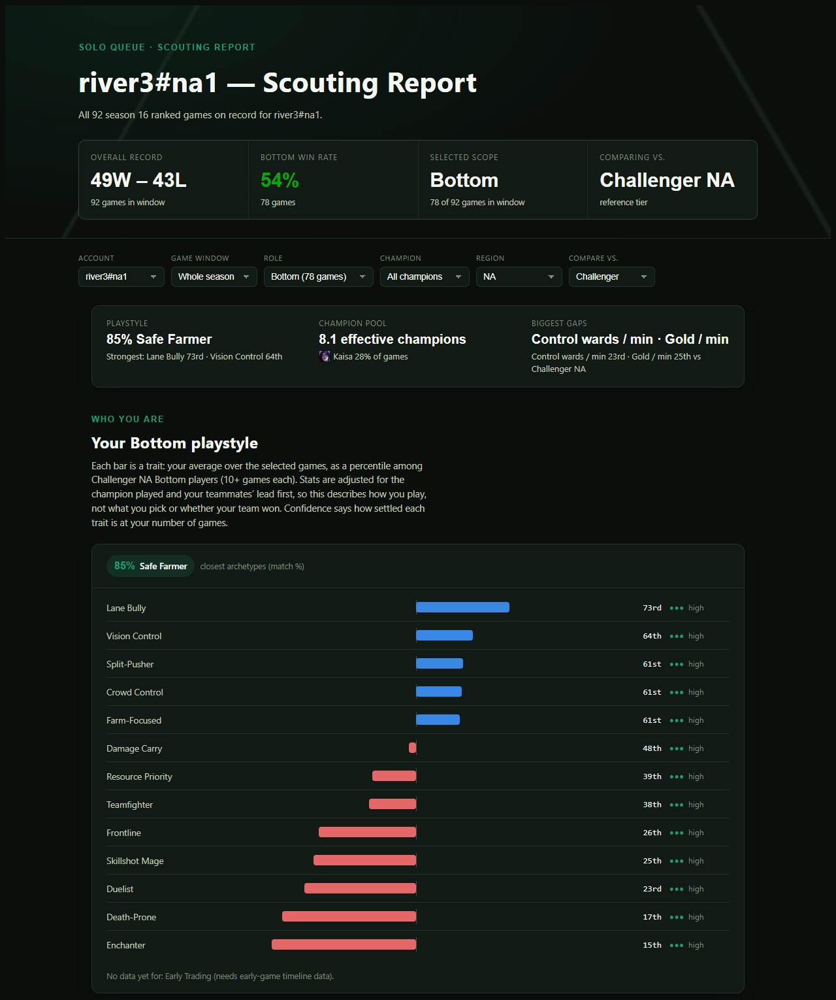

# Rift Archetypes

**What kind of League of Legends player are you, once you take away whether you won?**

Rift Archetypes pulls ~26k season-16 high-elo solo queue games (~260k player-games, Diamond → Challenger, NA + KR) from the Riot API, clusters each role into *playstyle archetypes*, and builds an interactive scouting report that places your own games among them, with percentile comparisons against every reference tier and against LCK/LPL pros.

<!-- TODO: add a dashboard screenshot at docs/dashboard.png, then uncomment:

-->

## Building: from clusters to trait profiles

The current k-means clusters hit a known limit. Even after the champion and teammate adjustments below, every non-support role splits mainly into *carry / farmer / low-resource*, with cluster win rates from 37% to 74%. That's a resource-share axis more than a playstyle. Low silhouette scores, and a k search that settles on its minimum, point to a continuum that k-means cuts arbitrarily. In progress:

- **Trait axes instead of clusters.** Each game gets trait scores (e.g. laning, vision, teamfighting) from the adjusted features, now including the early-game timeline features. A player's profile is their average, ranked as a percentile against peers with 10+ games in the role. k-means becomes an exploratory notebook tool.
- **Soft archetype labels.** Your top matches with a match %, e.g. "72% Safe Farmer, 41% Vision-Focused Carry". These are labels, not boxes.
- **Confidence per trait.** How much a single game reveals about a player, combined with how many games you've played, gives a low / medium / high reliability for each trait.
- **Champion pool as its own layer.** Your class mix and champion concentration, compared with the reference tier's.
- **Fairer performance comparisons.** A class-matched reference, so a Jinx main isn't compared against every ADC game, plus a "biggest gaps" list against the selected tier.
- **One source of truth.** Today the dashboard refits clusters separately from `models/`; the trait design removes that split.

Later: pro team clustering from Oracle's Elixir data, since Riot's API doesn't expose LCK/LEC matches.

## The hard part: separating playstyle from outcome

Naively clustering per-minute stats doesn't find playstyles. It finds *how the game went*. A stomp inflates damage, gold, KDA and objectives all at once, so the first version's "archetypes" had win rates of ~15% / ~60% / ~90%: losing, average, winning. Most of the project is about removing that confound without throwing away real style signal.

1. **Adjust for game context, cluster the residuals.** Per role, every feature is regressed on game-context covariates and clustering runs on the residuals: "how did this game differ from a typical game in the same situation?" (`src/playstyle_space.py`)
2. **Control for teammates' lead, not the result.** Regressing on the win flag also subtracts out styles that *cause* wins. The adjustment now controls only for your four teammates' lead over the four enemies outside your lane, so your own contribution stays in. On season 16 data, this brings back ~40% of the raw outcome correlation, which is the part that's yours (|corr with win| 0.04–0.11 vs 0.19–0.24 raw).
3. **Adjust for champion.** Champion choice explained 15–22% of feature variance. Champion fixed effects cut that to 1–2%. Rare champions pool into their Data Dragon class. Split-half reliability of player style profiles is still ~0.5, so a real champion-independent style signal survives.
4. **Early-game timeline features.** End-of-game totals are mostly *effect*. What a player does before 14:00 (CS diff @10, gold/XP diff @14, early roams, trades, warding) is mostly *cause*, so it's a cleaner style signal. (`src/timeline_features.py`)
5. **Honest about structure.** Silhouette scores are modest (~0.12–0.15): playstyles form a continuum more than separate groups. The clusters are useful summaries, not natural kinds.

Comparisons follow a few fixed conventions:

- **Season-matched.** Baselines shift between seasons (bot-lane median CS/min ~7.4 in S15, ~8.1 in S16), so you're only ever compared within one season.
- **Averages vs. averages.** Your average is ranked against other players' averages (10+ games), not against single games, which have far more spread.
- **Percentiles, not raw differences**, and an explicit "insufficient data (n=X)" instead of an empty panel.
- **Percentiles use raw stats.** The outcome adjustment is only for clustering. For "how good is your gold/min", being ahead *is* the point.

## Testing

The accuracy suite encodes these conventions against real games whose expected values were checked by hand (`tests/`): CS including jungle camps, per-minute normalization, season tagging, remake exclusion, outcome and champion adjustment, and timeline features across all five roles.

```
pytest
```

The fixture games are real match payloads with every player identity replaced by a salted hash (`src/anonymize_fixtures.py`, enforced by `tests/test_fixture_privacy.py`).

## Quickstart

```
python -m venv venv
venv\Scripts\activate            # source venv/bin/activate on macOS/Linux
pip install -r requirements.txt
copy .env.example .env           # then fill in RIOT_API_KEY and RIOT_IDS
```

- `RIOT_API_KEY`: a development key from the [Riot developer portal](https://developer.riotgames.com). These expire every 24h.
- `RIOT_IDS`: your account(s) as `gameName#tagLine`, comma-separated. Every script that takes `--riot-id` defaults to this.

Then follow [Typical run order](#typical-run-order) below. The full pool pull takes a while on a dev key's rate limit. To analyze just yourself against an existing model, use `fetch_recent_self.py`.

---

# Pipeline reference

Pipeline:
1. Build a player pool from Riot league endpoints.
2. Fetch and dedupe match IDs across that pool.
3. Fetch full match payloads (and timelines for the early-game features).
4. Build a per-participant feature table.
5. Fit per-role playstyle clusters.
6. Compare your own matches against a reference tier.
7. Export the interactive dashboard.

## Scripts

### src/fetch_league_pool.py
Builds the raw player pool file.

Default behavior:
- `--tier DIAMOND`
- `--division II`
- `--num-pages 1`
- Output: `data/raw/league_entries.json`
- Overwrites output by default.

Key parameters:
- `--tier`
  - If `CHALLENGER`, `GRANDMASTER`, or `MASTER`: uses top-league endpoint (no division/page semantics).
  - Otherwise: uses paged entries endpoint and requires tier/division context.
- `--division`
  - Used only for non-top tiers.
- `--num-pages`
  - Used only for non-top tiers.
- `--positive-winrate-only`
  - Keeps only entries where `wins > losses`.
- `--append`
  - Merges with existing output by puuid instead of overwriting.
- `--output-path`
  - Destination JSON file.

Examples:
- Diamond II default slice:
  - `python src/fetch_league_pool.py`
- Diamond II with more pages:
  - `python src/fetch_league_pool.py --tier DIAMOND --division II --num-pages 5`
- Challenger only, positive winrate:
  - `python src/fetch_league_pool.py --tier CHALLENGER --positive-winrate-only --output-path data/raw/league_entries_challenger_poswr.json`

### src/fetch_match_ids.py
Reads league pool entries and collects deduped match IDs.

Outputs:
- `data/raw/match_ids.ndjson`
- `data/raw/checkpoints/match_ids_checkpoint.json`
- `data/raw/failures/match_ids_failures.ndjson`

Important behavior:
- Always includes your own accounts (`RIOT_IDS` in `.env`) even if they are not present in the league pool file. Disable with `--skip-default-riot-ids`.
- Resolves Riot IDs to puuid via account-v1.
- Dedupes match IDs globally.

### src/fetch_match_details.py
Reads `match_ids.ndjson` and fetches full match payloads. Auto-routes each match ID to the correct regional cluster based on its platform prefix (`KR_...` -> `asia`, `NA1_...` -> `americas`, etc.). match-v5 lookups 404 through the wrong cluster, so a single run safely handles a `match_ids.ndjson` that mixes regions. `--platform` is only a fallback for an unrecognized prefix.

Outputs:
- `data/raw/matches.ndjson`
- `data/raw/checkpoints/match_details_checkpoint.json`
- `data/raw/failures/match_details_failures.ndjson`

### src/fetch_match_timelines.py + src/build_timeline_features.py
Resumable fetch of match-v5 timelines for the subset that matters (your own games + players with 10+ games in a role), or `--all` for a full-season backfill. Timelines are stored gzipped, one file per match (`data/raw/timelines/<matchId>.json.gz`, ~35-40 KB each vs ~0.4-1.3 MB raw), so new features can be re-extracted later without refetching. `build_timeline_features.py` turns them into the early-game feature table described in `src/timeline_features.py`.

### src/fetch_recent_self.py
Pulls your own ranked match history directly (resolve Riot ID -> paginate match-v5 -> match details) without scanning the full league pool. By default it paginates until it runs out of history (100 IDs per call, the API max); pass `--max-games` to cap it. Appends into the same `match_ids.ndjson`/`matches.ndjson` files, so a normal `build_features.py` run picks the new games up. Safe to re-run: already-fetched IDs/details are skipped.

- Run: `python src/fetch_recent_self.py` (all history for every account in `RIOT_IDS`), add `--max-games 50`, or `--since 2026-01-08` to only pull the current season (comparisons are season-matched anyway, so older games are never used). `--riot-id "yourname#na1"` overrides `RIOT_IDS`.

### src/eda_overview.py
Profiles the collected JSON/NDJSON files and writes a markdown schema and descriptive-statistics report.

- Report: `data/raw/eda_report.md`
- Example: `python src/eda_overview.py --max-records 500`

### src/summarize_feature_variables.py
Reads `eda_report.md`, groups potential participant-level variables by analysis theme, and flags identifiers, target leakage, constants, and sparse fields.

- Report: `data/raw/feature_variable_summary.md`
- Run: `python src/summarize_feature_variables.py`

### src/feature_config.py
Curated (hand-reviewed, not auto-parsed) list of participant fields used for clustering, grouped by normalization strategy (already-normalized, per-minute rate, raw count). Update this file when adding/removing candidate features.

### src/build_features.py
Builds the per-participant feature table used for clustering.

- Drops non-solo-role rows (keeps `TOP`/`JUNGLE`/`MIDDLE`/`BOTTOM`/`UTILITY` only) and remakes/early-surrenders shorter than `--min-game-length-seconds` (default 5 min).
- Applies per-minute normalization from `feature_config.py`, plus derived features (`cs_total_per_min` = lane minions + jungle camps, the "CS" number op.gg and the client show; `cs_per_min` alone is minions only).
- Tags every row with `patch`, `season` (Riot's major version: 16 = 2026) and `gameCreation`.
- Attaches source tier **and region** per puuid by matching against all `data/raw/league_entries*.json` pool files (`fetch_league_pool.py` tags every saved row with `platform`; files predating that default to NA1).
- Output: `data/processed/participant_features.parquet`
- Run: `python src/build_features.py`

### src/playstyle_space.py
Shared "playstyle space" transform used by clustering, `compare_self.py`, the dashboard export and the notebooks: context adjustment → `StandardScaler` → `PCA`. See [the hard part](#the-hard-part-separating-playstyle-from-outcome) for why the adjustment exists. Game length is a covariate (a spline) because champion level, killing sprees, turret plates and max lane leads are per-game totals or maxima that grow with game length, non-linearly in champion level's case (XP curve, cap at 18). Without it, the shortest games formed their own "low everything" cluster. Exact-duplicate features (e.g. Riot's `gold_per_minute` vs. our `gold_earned_per_min`) are excluded from clustering so they don't double-weight one dimension. The fitted adjustment lives in each role's model artifact, so every consumer projects rows identically.

Clusters are named after their two most distinctive playstyle traits (e.g. "Vision Control · Frontline", "Enchanter · Skillshot Mage"). Traits are groups of standardized, adjusted features, filtered per role so names like "Jungle Farmer" only appear for junglers.

### src/champion_classes.py
Primary Data Dragon class per champion, used to pool rare champions in the champion adjustment. Case-insensitive, since match data spells `FiddleSticks` and Data Dragon `Fiddlesticks`.

### src/build_clusters.py
Fits a separate adjustment → `StandardScaler` → `PCA` → `KMeans` pipeline per role (role is the dominant driver of raw stats, so clustering is done within-role rather than globally). Sweeps k and reports silhouette score to pick the cluster count per role (override with `--k-override ROLE=K`). The centroid report lists each cluster's name, win rate and most common champions.

- Models: `models/<role>_cluster.joblib`
- Cluster assignments: `data/processed/participant_clusters.parquet`
- Centroid report: `data/processed/cluster_centroid_report.md`
- Run: `python src/build_clusters.py`

### src/compare_self.py
Assigns your own matches to the fitted per-role clusters and compares your per-feature averages/percentiles against a reference tier (default Challenger).

- Run: `python src/compare_self.py` (accounts from `RIOT_IDS`; or `--riot-id "yourname#na1"` / `--puuid <puuid>`, repeatable)
- Output: `data/processed/self_comparison.csv`

### src/build_pro_features.py
Builds a per-player-per-game feature table from [Oracle's Elixir](https://oracleselixir.com/tools/downloads)'s professional match data CSV (LCK/LPL by default; any league code in the `league` column works via `--leagues`), for comparing your own stats against pro players. Oracle's Elixir's schema doesn't have our `challenges`-style derived stats, so only a subset of features carry a clean equivalent (no CC time, no lane-opponent-diff data). See the script for exactly which fields map to what.

Their download is Google Drive-hosted and its anonymous-download quota is sometimes exhausted for a while. If `gdown <file-id>` fails with a quota error, download the file manually in a logged-in browser instead and place it at `--input-path`.

- Run: `python src/build_pro_features.py`
- Output: `data/processed/pro_player_features.parquet`

### src/export_dashboard_data.py + src/build_dashboard.py
Builds a self-contained, **interactive** HTML "scouting report" dashboard. `export_dashboard_data.py` precomputes everything up front for every configured account, every role, every reference tier, and cluster counts k=3-6 (percentile reference curves via percentile breakpoints, PCA scatter positions + per-point cluster assignments, PCA axis explainability captions), so the dashboard filters entirely client-side with no server round trip. `build_dashboard.py` merges the resulting `data/processed/dashboard_data.json` into `dashboard/template.html` to produce a single HTML file.

Dashboard filters:
- **Account**: switch between configured Riot IDs (e.g. main + smurf) entirely in the browser.
- **Game window**: last 20 / last 50 / all time.
- **Role**: any role you have games in, or "All Roles" for an overall (non-role-specific) view. The percentile chart still works there (aggregated across roles), but the archetype cards and cluster-space scatter require picking a specific role, since clustering is fit separately per role.
- **Champion**: narrow to one champion within the selected role, or all champions.
- **Region**: which platform's ranked population to compare against (NA, KR, ...; only regions with enough sample size for the selected role are offered).
- **Compare vs.**: reference tier within the selected region, ordered Challenger > Grandmaster > Master > Diamond (whichever tiers have enough sample size).
- **Playstyles (k)**: 3 to 6 clusters; cards, scatter colors, legend, and table archetypes all update together.

Note: clustering (archetype cards, cluster-space scatter) is fit on the **combined** population across all regions for a role. It isn't split by region. Only the percentile-comparison reference curves are region-specific.

Each archetype card shows the cluster's dominant traits and most common champions, plus two comparisons against the population: your win rate within that cluster, and your *share* of games landing in it (over/under-represented vs. the population's own distribution across clusters).

Champion icons are fetched from Data Dragon at export time, cached under `data/raw/champion_icon_cache/`, and embedded as base64 data URIs in the dashboard JSON, so the HTML file works offline and under strict content security policies.

Note: cluster counts here are fit fresh per k on the same per-role PCA space purely for the dashboard's slider. They don't change or replace the "official" per-role models in `models/` that `compare_self.py` uses (those keep whatever k `build_clusters.py`'s silhouette search picked).

A separate **"vs. Professional Play"** section compares you against LCK/LPL pro players (a league toggle switches between them), built from `build_pro_features.py`'s output if present. It uses a smaller feature set than the solo-queue comparison since Oracle's Elixir's schema doesn't cover everything Riot's match-v5 API does.

Below that, **"Which pro do you play like?"** finds your nearest pro player match: each qualifying pro (5+ games in a role this season) gets a season-average stat profile, standardized against the pro population's own mean/std per feature; your current stat profile (respecting every active filter: account, window, role, champion) is standardized the same way and compared by Euclidean distance to find the 3 closest pros in the selected league. This runs entirely client-side.

- Run: `python src/build_pro_features.py` (optional, for the pro comparison) then `python src/export_dashboard_data.py` (accounts from `RIOT_IDS`, or repeat `--riot-id`) then `python src/build_dashboard.py`

## Notebooks

All scripts in `src/` are runnable interactively from `notebooks/`. Each notebook cell simulates the script's CLI invocation (`sys.argv` + `parse_args()`), so the notebooks stay in sync with the scripts automatically rather than duplicating logic.

- **notebooks/00_pull_data.ipynb**: pull your own recent/full match history (wraps `fetch_recent_self.py`), rebuild the feature table, and optionally refresh the full ranked pool.
- **notebooks/01_explore_clusters.ipynb**: PCA scatter plots per role, centroid bar charts, and tier mix per cluster, reading from `data/processed/` and `models/`.
- **notebooks/02_self_analysis.ipynb**: interactive version of `compare_self.py`: a styled percentile table, a percentile bar chart, cluster distribution, and a per-game stat trend over time.
- **notebooks/03_generate_dashboard.ipynb**: runs `export_dashboard_data.py` + `build_dashboard.py` and sanity-checks the result.

## Typical run order

1. Build pool (one file per tier *and* per region: `build_features.py` infers tier from the filename for apex tiers, so don't merge tiers into one file; `fetch_league_pool.py` tags every row with its `--platform` so region is never ambiguous even if you do)
- `python src/fetch_league_pool.py --tier DIAMOND --division II`
- `python src/fetch_league_pool.py --tier MASTER --output-path data/raw/league_entries_master.json`
- `python src/fetch_league_pool.py --tier GRANDMASTER --output-path data/raw/league_entries_grandmaster.json`
- `python src/fetch_league_pool.py --tier CHALLENGER --output-path data/raw/league_entries_challenger.json`
- For another region, add `--platform <region>` and a matching filename, e.g.: `python src/fetch_league_pool.py --platform kr --tier CHALLENGER --output-path data/raw/league_entries_kr_challenger.json`

2. Collect match IDs (once per pool file: `fetch_match_ids.py` only reads one `--league-entries-path` per run; pass the matching `--platform` for non-NA files, and add `--skip-default-riot-ids` on the non-Diamond runs to avoid redundantly re-resolving your own accounts each time). Master/Grandmaster pools can be huge (NA and KR Master were both 10,000 players, the API's page cap), so cap with `--max-players` to keep runtime and dataset size proportionate to the other tiers. Match IDs are globally unique across regions (platform-prefixed, e.g. `KR_...` vs `NA1_...`), so every region can share the same `match_ids.ndjson`/`matches.ndjson`.
- `python src/fetch_match_ids.py --resume`
- `python src/fetch_match_ids.py --league-entries-path data/raw/league_entries_master.json --max-players 300 --skip-default-riot-ids --checkpoint-path data/raw/checkpoints/match_ids_master_checkpoint.json`
- `python src/fetch_match_ids.py --league-entries-path data/raw/league_entries_grandmaster.json --max-players 300 --skip-default-riot-ids --checkpoint-path data/raw/checkpoints/match_ids_gm_checkpoint.json`
- `python src/fetch_match_ids.py --league-entries-path data/raw/league_entries_challenger.json --skip-default-riot-ids --checkpoint-path data/raw/checkpoints/match_ids_challenger_checkpoint.json`
- `python src/fetch_match_ids.py --platform kr --league-entries-path data/raw/league_entries_kr_challenger.json --skip-default-riot-ids --checkpoint-path data/raw/checkpoints/match_ids_kr_challenger_checkpoint.json` (repeat per KR tier, same `--max-players` caps as above)

3. Fetch match payloads (and timelines)
- `python src/fetch_match_details.py --resume`
- `python src/fetch_match_timelines.py`

4. Build features
- `python src/build_features.py`
- `python src/build_timeline_features.py`

5. Fit clusters
- `python src/build_clusters.py`

6. Compare yourself
- `python src/compare_self.py`

7. Build the dashboard
- `python src/export_dashboard_data.py`
- `python src/build_dashboard.py`

To refresh with just your own newest games (skips re-scanning the full pool):
- `python src/fetch_recent_self.py`
- then re-run steps 4, 6, 7 (no need to refit clusters unless the population itself changed materially)

## Notes

- Riot developer keys expire every 24h. If requests suddenly fail with 401, regenerate the key and update `.env`.
- Raw data files under `data/raw/` are intentionally gitignored, as are `data/processed/` and `models/` (both regenerable from `data/raw/`).

---

## License and credits

Code: [MIT](LICENSE). Match data via the [Riot Games API](https://developer.riotgames.com); pro match data from [Oracle's Elixir](https://oracleselixir.com).

Rift Archetypes isn't endorsed by Riot Games and doesn't reflect the views or opinions of Riot Games or anyone officially involved in producing or managing Riot Games properties. Riot Games, and all associated properties are trademarks or registered trademarks of Riot Games, Inc.
